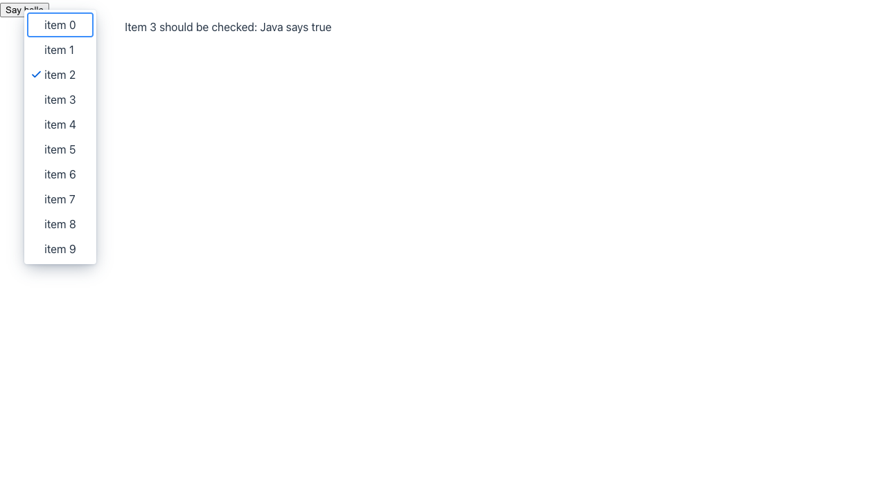

> [!WARNING]
> Automated reproduction by the Claude Code `repro` skill. Needs human verification.

**Reproduced** on `main` (25.4-SNAPSHOT). Not a regression.

**Root cause**: The context menu renders its items, including the `menu-item-checked` attribute, when it opens. The opened-change listener runs on the server after that render, so its `setChecked` calls arrive while the overlay is already open. `MenuItemBase.setChecked` updates the `_checked` property, but the connector toggles the attribute only for `keepOpen` items. Nothing renders the open menu again, so the checkmark shows the state from before the listener ran.

https://github.com/vaadin/flow-components/blob/bcfbe5c930bde1163296b5a66dfc8fb672bbc4af/vaadin-context-menu-flow-parent/vaadin-context-menu-flow/src/main/resources/META-INF/frontend/vaadin-context-menu/contextMenuConnector.ts#L115-L126

https://github.com/vaadin/web-components/blob/01c6ab6191b11dbdc137e7a4f1ed13a90ce921e5/packages/context-menu/src/vaadin-contextmenu-items-mixin.js#L195

Reproduction: branch [`repro/1010-2`](https://github.com/vaadin/flow-components/tree/repro/1010-2), route `/repro-1010`.

Details

The opened-change listener moves the checked item by one on each open. Measured on the open overlay after the server roundtrip:

| Open | Status text from the server | Item with `_checked=true` | Item with the visible checkmark |
| --- | --- | --- | --- |
| 1st | `Item 1 should be checked: Java says true` | item 1 | **item 0** |
| 2nd | `Item 2 should be checked: Java says true` | item 2 | **item 1** |
| 3rd | `Item 3 should be checked: Java says true` | item 3 | **item 2** |

The client state is correct. Only the rendered attribute lags one open behind. This still happens after #9943 changed the item state to live getters.

