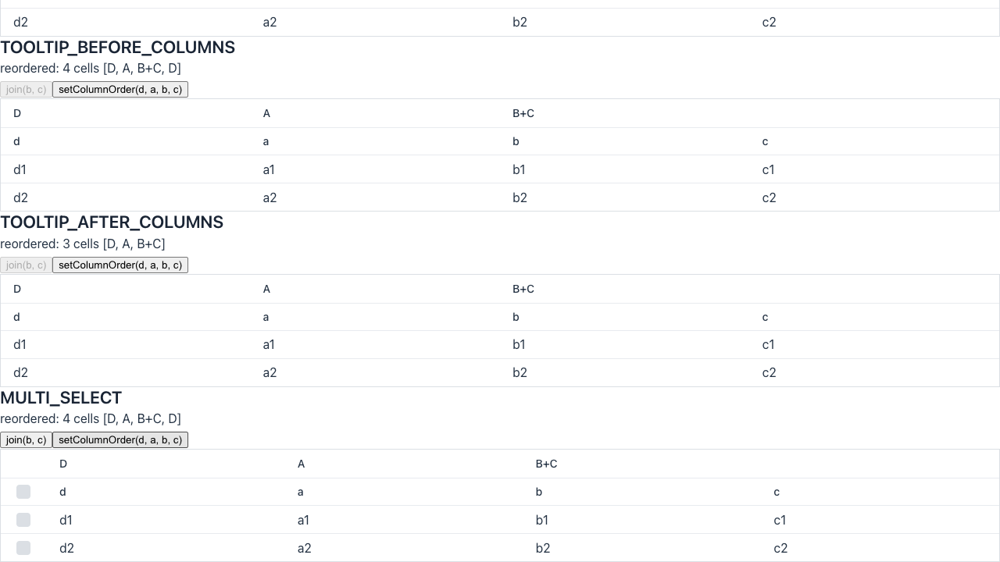

<!-- Edit any field. This file is committed on the `repro/<issue>` branch and posted as the issue comment. -->

> [!WARNING]
> **Automated reproduction — produced by the Claude Code `repro` skill. Needs human verification.**
> The steps, verdict, and root-cause pointer below were generated automatically and must be confirmed by a human before being treated as authoritative.

- **Verdict:** reproduced
- **Hypothesis tested:** The bug is a stale cell left in `HeaderRow.getCells()`, triggered by `join(...)` when a non-column element precedes the columns in the grid element, observable as 4 cells `[A, B+C, B, D]` instead of 3.
- **Regression?:** not a regression (the index logic in `joinCellsInPlace` dates from 2018)
- **Fixed by:** n/a
- **Duplicate of:** none found (#9086 has the same root cause, but it was closed as an unsupported custom-slot case)
- **Branch:** `repro/10640` — pushed to `vaadin/flow-components`
- **Reproduced on:** flow-components @ `main` (25.4-SNAPSHOT, `bcfbe5c930`)
- **Present on main?:** yes (still broken)
- **Theme / Browser:** Lumo / Chromium (playwright-cli)
- **Screenshot** (static bug): 
- **Demo video** (motion bug): n/a

## Observed behavior

The view reports `row.getCells()` on the server for four grids.

| Case | After `join(b, c)` | After `setColumnOrder(d, a, b, c)` |
| --- | --- | --- |
| Control (no tooltip, single select) | 3 cells `[A, B+C, D]` | 3 cells `[D, A, B+C]` |
| Tooltip generator set before columns | 4 cells `[A, B+C, B, D]` | 4 cells `[D, A, B+C, D]` |
| Tooltip generator set after columns | 3 cells `[A, B+C, D]` | 3 cells `[D, A, B+C]` |
| Multi-select, join after attach | 4 cells `[A, B+C, B, D]` | 4 cells `[D, A, B+C, D]` |

The rendered header is correct in all four cases: `A | B+C (colspan 2) | D`.
Only the server-side row state is wrong.

The server ran without `-ea`, so `setColumnOrder` did not throw.
With `-ea`, `assert columns.size() == cells.size()` in `AbstractRow.setColumns` fails for the two broken cases.

In the broken cases the first child of `<vaadin-grid>` is not a column:

- Tooltip before columns: `vaadin-tooltip[slot=tooltip]` is child 0.
- Multi-select after attach: `vaadin-grid-flow-selection-column` is child 0.

In the tooltip-after-columns case, `vaadin-tooltip` comes after the column groups, and the join works.

## Expected behavior

After `join(b, c)`, `row.getCells()` has 3 cells: `[A, B+C, D]`.
After `setColumnOrder(d, a, b, c)`, it has `[D, A, B+C]`, and no error is thrown.

## Steps to reproduce

1. Open `http://localhost:8080/repro-10640`.
2. Read the status line under `TOOLTIP_BEFORE_COLUMNS`. It shows `joined: 4 cells [A, B+C, B, D]`.
3. Click `join(b, c)` under `MULTI_SELECT`. The status shows `joined: 4 cells [A, B+C, B, D]`.
4. Click `setColumnOrder(d, a, b, c)` in either broken case. The status shows `reordered: 4 cells [D, A, B+C, D]`.
5. Compare with `CONTROL`, which shows 3 cells at every step.

## Reproduction

How to run: start the server (`mvn package jetty:run -am -DskipTests -pl vaadin-grid-flow-parent/vaadin-grid-flow-integration-tests`) and open the route below.

- **Route / page:** `http://localhost:8080/repro-10640`
- **Scaffold:** `vaadin-grid-flow-parent/vaadin-grid-flow-integration-tests/src/main/java/com/vaadin/flow/component/grid/it/Repro10640View.java`

```java
Grid<String> grid = new Grid<>();
grid.setTooltipGenerator(item -> item); // before the columns are added

Grid.Column<String> a = grid.addColumn(item -> "a" + item).setHeader("a");
Grid.Column<String> b = grid.addColumn(item -> "b" + item).setHeader("b");
Grid.Column<String> c = grid.addColumn(item -> "c" + item).setHeader("c");
Grid.Column<String> d = grid.addColumn(item -> "d" + item).setHeader("d");

HeaderRow row = grid.prependHeaderRow();
row.getCell(a).setText("A");
row.getCell(b).setText("B");
row.getCell(c).setText("C");
row.getCell(d).setText("D");
row.join(b, c).setText("B+C");

// row.getCells(): [A, B+C, B, D], expected [A, B+C, D]
grid.setColumnOrder(d, a, b, c);
// row.getCells(): [D, A, B+C, D], expected [D, A, B+C]
```

## Root cause (suspected)

`joinCellsInPlace` uses `elementInsertIndex`, a child index in the grid element, as an index into the `cells` list.
`this.cells.get(elementInsertIndex)` is meant to return the new joined cell, so that `removeAll` keeps it.
The two indexes match only when the column elements start at child 0.
With a tooltip or selection column in front, the lookup returns the old `B` cell.
The old `B` cell is then kept, and only `C` is removed.
`cellInsertIndex` is the correct index for that lookup.

https://github.com/vaadin/flow-components/blob/bcfbe5c930bde1163296b5a66dfc8fb672bbc4af/vaadin-grid-flow-parent/vaadin-grid-flow/src/main/java/com/vaadin/flow/component/grid/AbstractRow.java#L375-L393

## Notes

- `FooterRow.join(...)` shares the same code, so it is expected to have the same problem. This was not tested.
- The reporter's demo project (`vapp-25.3.5.zip`) uses the same two triggers. Its views were read, but the project was not run.
- #9086 reported the same index mismatch with a custom slotted element. It was closed as unsupported.
- No dependency was added to the integration tests `pom.xml`.
- Browser console was clean.
