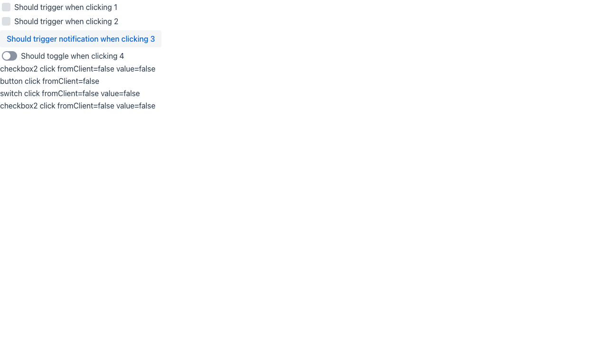

> [!WARNING]
> Automated reproduction by the Claude Code `repro` skill. Needs human verification.

**Reproduced** on `main` (25.4-SNAPSHOT). Not a regression.

**Root cause**: `addClickShortcut` comes from Flow's `ClickNotifier`. It only fires a server-side `ClickEvent` and never dispatches a click on the client element. `Checkbox` and `Switch` inherit it without an override, and their checked state only changes in the web component on a real DOM click. Click listeners run with `fromClient=false`, but the value never changes.

https://github.com/vaadin/flow/blob/cc4b9e62f4d2b9b240b5410644726596263ed12b/flow-server/src/main/java/com/vaadin/flow/component/ClickNotifier.java#L148-L154

Reproduction: branch [`repro/5362`](https://github.com/vaadin/flow-components/tree/repro/5362), route `/repro-5362`.

Details

| Case | Result |
| --- | --- |
| `Checkbox` without click listener, shortcut <kbd>1</kbd> | Stays unchecked, no value change event |
| `Checkbox` with click listener, shortcut <kbd>2</kbd> | Click listener fires (`fromClient=false`), stays unchecked |
| `Button`, shortcut <kbd>3</kbd> (control) | Click listener fires |
| `Switch` with click listener, shortcut <kbd>4</kbd> | Click listener fires (`fromClient=false`), stays off |
| Mouse click on each `Checkbox` and the `Switch` | Toggles, value change event with `fromClient=true` |

Checkable `MenuItem` has the same symptom with the same Flow API: #8085.

