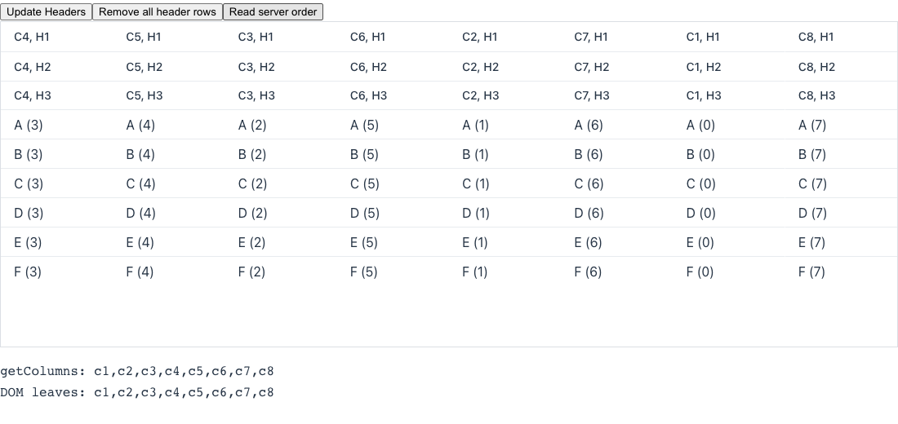

> [!WARNING]
> Automated reproduction by the Claude Code `repro` skill. Needs human verification.

**Reproduced** on `main` (25.4-SNAPSHOT). Not a regression: `removeAllHeaderRows()` shipped in 24.4.0, and the Flow logic below dates from 2022.

**Root cause**: The bug is in Flow core, not in Grid. The server element tree stays correct, but Flow sends wrong splice indexes to the client. In one round trip, `updateHeaders()` moves every column from its group to the grid and then into a new group. `NodeList.addChange` drops the add change of each column, because the column is removed again in the same round trip. `reindexChanges` then lowers the index of every later change above that position. This includes the add of the next new group, which was recorded when the column was not in front of it. Frozen columns are not needed to trigger it.

https://github.com/vaadin/flow/blob/cc4b9e62f4d2b9b240b5410644726596263ed12b/flow-server/src/main/java/com/vaadin/flow/internal/nodefeature/NodeList.java#L298-L308

https://github.com/vaadin/flow/blob/cc4b9e62f4d2b9b240b5410644726596263ed12b/flow-server/src/main/java/com/vaadin/flow/internal/nodefeature/NodeList.java#L324-L336

Reproduction: branch [`repro/6791`](https://github.com/vaadin/flow-components/tree/repro/6791), route `/repro-6791` (query parameters `columns`, `frozen`, `rows`).

<details>
<summary>Details</summary>

| Case (click "Update Headers") | Client column order |
| --- | --- |
| 2 columns, 2 header rows | 1 2 |
| 3 columns, 2 header rows | 2 1 3 |
| 4 columns, 2 or 3 header rows | 2 3 1 4 |
| 4 columns, 1 header row | 1 2 3 4 |
| 30 columns, 3 header rows, 3 frozen (issue) | 15 16 14 17 13 18 … 3 28 2 29 1 30 |
| `removeAllHeaderRows()` alone, then "Update Headers" in a later round trip | correct |

In all cases, `grid.getColumns()` and the server element tree stay in order `c1..cN`.

Splices sent for the grid node with 3 columns:

```
idx 0 rm 1   (×3, old groups)
idx 0 add 20 (group with c1)
idx 0 add 21 (group with c2)   ← should be idx 1
idx 2 add 22 (group with c3)
```

The client applies these splices as sent and gets `c2, c1, c3`. The pruning was added in vaadin/flow#14478.



</details>
