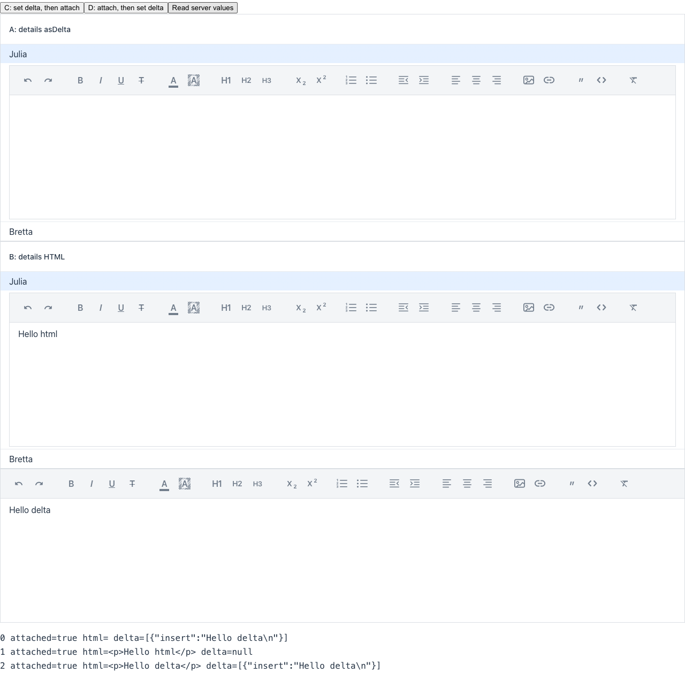

> [!WARNING]
> Automated reproduction by the Claude Code `repro` skill. Needs human verification.

**Reproduced** on `main` (25.4-SNAPSHOT). Regression status unknown.

On `main` the editor in the row details is empty, not "null". The Delta value is lost in both cases.

**Root cause**: `AsDelta.setValue` sets the `value` property. It then reads the HTML back with `executeJs("return this.htmlValue")`. A Grid details component is a virtual child, and it is still detached when that JavaScript runs. So Quill is not initialized, and `htmlValue` is `undefined`. The server HTML value stays empty. When the element connects, `onAttach` sends `dangerouslySetHtmlValue("")` and clears the Delta content. Nothing sends the content again.

https://github.com/vaadin/flow-components/blob/5389f45fdcde73bac743420d625c68b3c75ceaf7/vaadin-rich-text-editor-flow-parent/vaadin-rich-text-editor-flow/src/main/java/com/vaadin/flow/component/richtexteditor/RichTextEditor.java#L1192-L1201

https://github.com/vaadin/flow-components/blob/5389f45fdcde73bac743420d625c68b3c75ceaf7/vaadin-rich-text-editor-flow-parent/vaadin-rich-text-editor-flow/src/main/java/com/vaadin/flow/component/richtexteditor/RichTextEditor.java#L133-L139

Reproduction: branch [`repro/6826`](https://github.com/vaadin/flow-components/tree/repro/6826), route `/repro-6826`.

Details

| Case | Editor shows | Server HTML value |
| --- | --- | --- |
| A: Grid details, `asDelta().setValue()` in the renderer | empty | `""` (Delta property still set) |
| B: Grid details, `setValue(html)` in the renderer | Hello html | `
Hello html
` |
| C: `asDelta().setValue()`, then `add()` without Grid | Hello delta | `
Hello delta
` |
| D: `add()`, then `asDelta().setValue()` | Hello delta | `
Hello delta
` |

Client trace for case A:

1. `value` is set to the Delta while the element is detached.
2. `return this.htmlValue` runs while the element is still detached, with `connected=false editor=false`, and returns `undefined`.
3. The element connects, and Quill renders the Delta.
4. `dangerouslySetHtmlValue("")` from `onAttach` clears the editor.

In case C, the element is connected before the JavaScript runs. So `htmlValue` returns `
Hello delta
`. The server value change sends that HTML back and restores the content.

Not verified: the "null" text in the issue (24.5.4) probably comes from how `undefined` converts to a string. Elemental `JsonNull.asString()` returns `"null"`. On `main`, the server value stays `""`.

