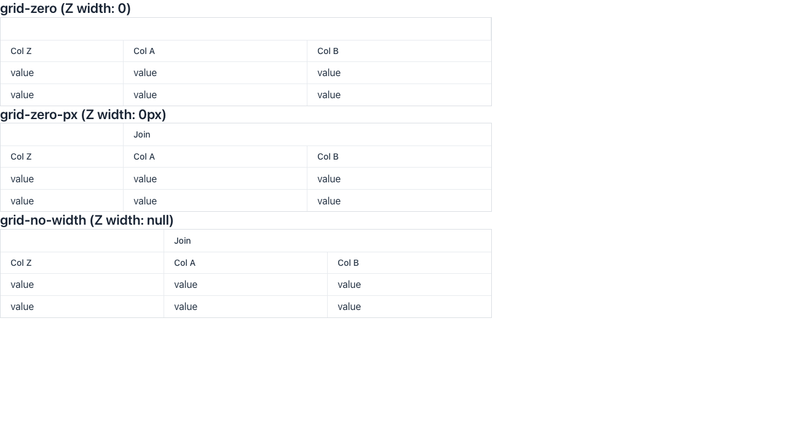

> [!WARNING]
> Automated reproduction by the Claude Code `repro` skill. Needs human verification.

**Reproduced** on `main` (25.4-SNAPSHOT, `@vaadin/grid` 25.4.0-alpha6). Not a regression.

**Root cause**: `prependHeaderRow()` wraps every column in a `vaadin-grid-column-group`. The group computes its width by joining the child widths into a `calc()` expression. A unitless `0` becomes `calc(0)`, which is a number and not a length, so the browser drops it as invalid CSS. The group header cell above "Col Z" then has no width and stretches across the grid, which pushes the "Join" cell past the right edge. The same width as `0px` renders correctly.

https://github.com/vaadin/web-components/blob/0c1f7b92eaaf06caa79841dadf853563e578039e/packages/grid/src/vaadin-grid-column-group-mixin.js#L191-L198

Reproduction: branch [`repro/6848`](https://github.com/vaadin/flow-components/tree/repro/6848), route `/repro-6848`.

Details

All grids are 800px wide. Column Z has `setFlexGrow(1)`, and columns A and B are joined in the top header row.

| Z width | Group `width` | Group cell `style.width` | Top header row (left + width) |
| --- | --- | --- | --- |
| `"0"` | `calc(0)` | empty (rejected) | Z group 1+798, "Join" 799+200 (outside the grid) |
| `"0px"` | `calc(0px)` | `calc(0px)` | Z group 1+200, "Join" 201+598 |
| not set | `calc(100px)` | `calc(100px)` | Z group 1+266, "Join" 267+532 |

The body columns and the bottom header row are laid out correctly in all three cases.

